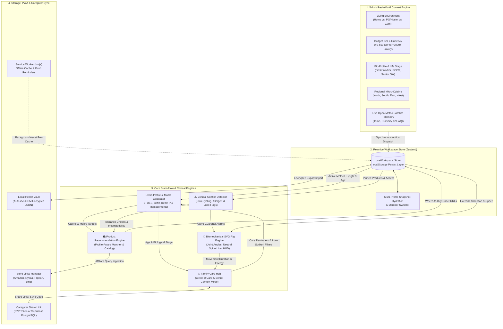

# 🏛️ AURA-CARE System Architecture & Engineering Blueprint

This document details the architectural decisions, state-machine mechanics, clinical rule pipelines, and security designs behind **AURA-CARE** (VitalForm) — an ultra-responsive, local-first holistic health, skincare, fitness, and family wellness super-app.

---

## 🎯 1. Architectural Philosophy: Solving Gaps in Generic Health Apps

Traditional fitness, diet, and skincare applications share common failure modes that isolate real-world users:

```
┌──────────────────────────────────────────────┬──────────────────────────────────────────────┐
│ Traditional Health Apps (Generic / Flawed)   │ AURA-CARE 5-Axis Context Engine Solution     │
├──────────────────────────────────────────────┼──────────────────────────────────────────────┤
│ 1. Assume full modular western kitchens      │ 🏠 vs 🏢 Living Setup: Full kitchen vs       │
│    (blenders, ovens, 4-burner stoves).       │ PG / Hostel Mode (kettle-only, zero-cook).   │
│                                              │                                              │
│ 2. Assume high discretionary luxury budgets  │ 💰 Dual-Currency Budget Tiers: Scaling from  │
│    (expensive imported supplements/serums).  │ ₹0–₹500 ($0–$6) DIY up to Clinical Luxury.   │
│                                              │                                              │
│ 3. Western-centric food databases (kale,     │ 🍛 Regional Micro-Cuisines: Authentic Indian │
│    quinoa, avocado toast, greek yogurt).     │ (North, South, East, West) & global staples. │
│                                              │                                              │
│ 4. Treat exercise as generic animated GIFs   │ 📐 Biomechanical SVG Rig: Dynamic joint angle│
│    without form checks or angle safety.      │ readouts, spine alignment lines & tempo cues.│
│                                              │                                              │
│ 5. Disregard real-time seasonal physics      │ 🌤️ Satellite Weather Shield: Live Open-Meteo │
│    (TEWL in winter, UV in summer, smog AQI). │ mapping to UV, Ceramide & Smog barriers.     │
│                                              │                                              │
│ 6. Ignore aging parents and elders living    │ 👵 Family Care Hub & P2P Caregiver Link:     │
│    in multi-generational households.         │ Medication checks, gentle walks, and sync.   │
│                                              │                                              │
│ 7. Force mandatory cloud account logins and  │ 🛡️ Local-First Primary Store: 100% guest-    │
│    harvest user biometric health data.       │ ready via localStorage + encrypted backups.  │
└──────────────────────────────────────────────┴──────────────────────────────────────────────┘
```

---

## 🏗️ 2. End-to-End System Architecture Diagram



---

## 🧬 3. Core Component & State Pipeline Breakdown

### 1. The Reactive Workspace Store (`src/store.ts`)
The entire application state is unified within a typed Zustand store utilizing the `persist` middleware. It supports multi-profile workspace switching (`memberWorkspaces`) under an atomic snapshot model:

```ts
export interface WorkspaceData extends PersonWorkspace {
  currency: Currency;                 // 'INR' | 'USD'
  theme: 'light' | 'dark';           // Strict dark mode token guard
  familyMembers: FamilyMember[];      // Multi-generational circle profiles
  activeMemberId: string;            // 'self' | UUID
  memberWorkspaces: Record<string, PersonWorkspace>;
  weatherMode: 'auto' | 'manual';     // Satellite telemetry auto-sync
  selectedCity: string;              // Indian/Global city coordinates
  liveClimate: LiveClimateReport | null;
  notificationConfig: NotificationConfig;
}
```

### 2. Bio-Profile & Adaptive Nutrition Core (`src/profile.ts` & `src/personalizedNutrition.ts`)
- **Metabolic Baseline:** Computes Basal Metabolic Rate (BMR) via the Mifflin-St Jeor formula and Total Daily Energy Expenditure (TDEE) based on occupational activity coefficients.
- **Pantry & Living Context Substitution:**
  - In `home` mode: Allocates multi-step culinary preparations (steamed idlis, pressure-cooked khichdi, grilled tofu).
  - In `pg` mode: Bans all stove recipes; dynamically converts meal slots to electric kettle soaking (sprouted green moong, boiled chana, roasted sattu beverages, paneer salads).

### 3. Clinical Safety & Active Conflict Detector (`src/formulas.ts` & `src/safety.ts`)
- **Skin Cycling Engine:** Detects clashes between potent actives (e.g., Retinoids + Direct AHA/BHA Acids) and triggers guardrail warnings in `MistakeGuardrailBanner.tsx`.
- **Patch-Test Ramp:** Automatically schedules a 21-day tolerance introduction protocol whenever a high-potency formula (e.g. 0.1% Retinaldehyde, 10% L-Ascorbic Acid) is pinned.

### 4. Biomechanical SVG Rig & Posture Engine (`src/components/BiomechanicalExercisePlayer.tsx`)
- **Dual-Tone Anatomical Depth:** Renders near-side limbs in Cobalt/Cyan gradients and far-side limbs in Violet/Purple gradients to convey depth during 2D projections.
- **Dynamic Spine Alignment Line:** Mathematically plots quadratic Bézier curves between cervical, thoracic, and lumbar vertebrae. Curves switch from emerald green to crimson warning arcs if lumbar rounding occurs.
- **Performance Optimization via `IntersectionObserver`:**
  - Wraps the player stage container with a viewport observer.
  - Off-screen instances automatically disconnect `PlaybackClock` and `useAnimationFrame`, dropping CPU usage to zero when the user scrolls past.

### 5. Multi-Generational Family Care Hub (`src/components/FamilyCareHub.tsx`)
- Supports up to 20 family profiles per local device.
- Evaluates **Elder & Senior Comfort Mode** (`comfort.css`) for profiles aged 40+, enforcing minimum **18px body typography** and **48px touch targets**.
- Tracks daily mobility minutes, pain ratings (`0–10`), subjective mood, and time-stamped prescription reminders.

---

## 🔐 4. Privacy, Security & Cryptography Design

### Zero Mandatory Cloud Accounts
1. **Local-First by Default:** All measurements, journals, and logs live strictly inside the client's browser `localStorage`.
2. **Encrypted Local Vault (`src/vault.ts`):**
   - Implements Web Crypto API standards.
   - Derives a 256-bit AES key via **PBKDF2** with **600,000 SHA-256 iterations** and a 16-byte cryptographically secure random salt.
   - Encrypts backup JSON payloads using **AES-256-GCM** with a unique 12-byte initialization vector (IV).
3. **Caregiver Share Tokenization:**
   - **Offline P2P Mode:** Encodes elder care vitals into an URL-safe base64 hash (`#family-sync/P2P_<encoded>`), allowing cross-device sharing with zero server database storage.
   - **Optional Supabase Mode:** When `VITE_SUPABASE_URL` is configured, stores packets in PostgreSQL with strict Row Level Security (RLS) policies.
4. **Sanitized Social Exports (`ShareRoutineCardModal.tsx`):**
   - Strips all private biological metrics (body weight, BMI, target kilograms) and clinical medical flags before rendering shareable WhatsApp routine cards.

---

## 📡 5. Centralized Affiliate Link Management (`src/config/storeLinks.ts`)

To monetize product recommendations ethically without hardcoding affiliate tracking into UI components:
- **`buildStoreUrl(platform, queryOrUrl)`:**
  - Intercepts all product and store search links across Amazon India, Flipkart, Nykaa, Tata 1mg, and PharmEasy.
  - Automatically appends active affiliate tags (`tag`, `affid`, `utm_source`) configured in `.env.local`.
  - Canonical fallback: If environment tags are empty, clean retailer search URLs are output without tracking cookies.

---

## ⚡ 6. Lighthouse 95+ Audit Standards

| Metric / Audit Category | Architecture Strategy Implemented |
| :--- | :--- |
| **Performance (95+)** | Code-split dynamic imports (`React.lazy`), manual vendor chunking in Vite, `IntersectionObserver` off-screen animation pausing, Service Worker pre-caching, immutable asset cache headers (`max-age=31536000`). |
| **Accessibility (95+)** | WCAG 2.1 AA color contrast compliance, Senior Comfort Mode (18px body font, 48px touch targets), keyboard skip links, semantic HTML5 landmarks, native screen reader ARIA bindings. |
| **Best Practices (95+)** | Strict TypeScript compilation (`noUnusedLocals`, `noEmit`), HTTPS enforcement, HTTP security headers (`nosniff`, `DENY`, `strict-origin-when-cross-origin`, `Permissions-Policy`), valid PWA manifest. |
| **SEO (95+)** | Dynamic page titles (`App.tsx`), full OpenGraph & Twitter metadata, mobile viewport meta, crawler-accessible `robots.txt`, and XML `sitemap.xml`. |
