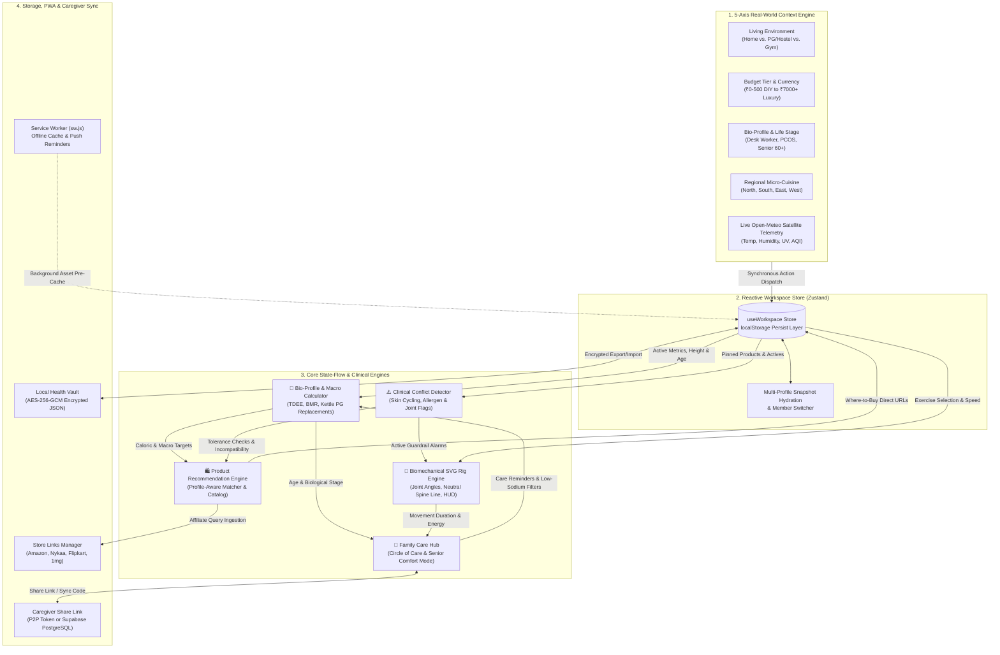

# 🌟 AURA-CARE (VitalForm)
### Hyper-Contextual Holistic Health, Skincare, Fitness & Family Wellness Super-App

[](https://www.typescriptlang.org/)
[](https://react.dev/)
[](https://vitejs.dev/)
[](https://tailwindcss.com/)
[](https://web.dev/progressive-web-apps/)
[](https://pagespeed.web.dev/)
[](LICENSE)

A production-grade, local-first Progressive Web App (PWA) designed to eliminate the gaps in generic wellness applications. Powered by an adaptive **5-Axis Real-World Context Engine**, AURA-CARE dynamically personalizes clinical skincare, biomechanical movement, and regional nutrition around a user’s physical living setup, financial budget tier, climate telemetry, and family life stage.

---

## 🎯 1. Problem & Solution Overview

### The Real-World Gap in Generic Health Apps
Most wellness platforms are built around wealthy, Western assumptions:
- **Modular Western Kitchens:** They prescribe recipes requiring food processors, 4-burner gas ranges, and baking ovens—completely unviable for students or professionals living in PGs or hostels with only an electric kettle.
- **Inflated Discretionary Spending:** They push expensive imported supplements and $80 serums without considering users on student or zero-cost DIY budgets.
- **Western Food Databases:** They prioritize kale salads and Greek yogurt over culturally authentic, highly bioavailable regional Indian staples like moong sprouts, roasted sattu, ragi, and chana.
- **Static GIF Workout Demos:** They show generic looping animations without real-time joint degree targets, spinal neutrality lines, or tempo cues.
- **Climate Blindness:** They recommend the same routines year-round, ignoring seasonal trans-epidermal water loss (TEWL) in winter, UV index spikes in summer, and urban particulate smog (PM2.5).
- **Mandatory Data Harvesting:** They force account creation and sell biometric data to advertising networks.

### The AURA-CARE 5-Axis Solution

```
                               ┌────────────────────────────────────────────────────────┐
                               │             5-AXIS REAL-WORLD CONTEXT ENGINE           │
                               └───────────────────────────┬────────────────────────────┘
                                                           │
        ┌──────────────────┬──────────────────────┬────────┴─────────────┬──────────────────────┐
        ▼                  ▼                      ▼                      ▼                      ▼
┌──────────────┐   ┌──────────────┐       ┌──────────────┐       ┌──────────────┐       ┌──────────────┐
│ Living Setup │   │ Budget Tiers │       │ Bio-Profile  │       │ Regional Diet│       │ Weather Shield│
├──────────────┤   ├──────────────┤       ├──────────────┤       ├──────────────┤       ├──────────────┤
│ 🏠 Home vs   │   │ 🌱 Zero DIY  │       │ • Desk Worker│       │ • North Ind  │       │ • Winter Dry │
│ 🏢 PG Hostel │   │ 🎓 Student   │       │ • PCOS/Horm  │       │ • South Ind  │       │ • Summer UV  │
│ 💼 Office    │   │ ⚡ Mid Perf  │       │ • Postpartum │       │ • East/West  │       │ • Monsoon RH │
│ 🏋️ Gym Mode │   │ 💎 Luxury    │       │ • Senior 60+ │       │ • Med/Asian  │       │ • Smog AQI   │
└──────────────┘   └──────────────┘       └──────────────┘       └──────────────┘       └──────────────┘
```

1. **🏠 Living Setup Adaptation:** Instantly flips between full-kitchen home routines and **PG / Hostel Mode** (electric kettle soaking, no-cook meal assemblies, silent zero-jump workouts, and hard-water chelating rinses).
2. **💰 Dual-Currency Budget Tiers (INR ₹ & USD $):** Automatically recalibrates recommendations across 4 tiers:
   - 🌱 *Zero-Cost DIY* (`₹0–₹500` / `$0–$6`)
   - 🎓 *Student / Smart Value* (`₹500–₹2,000` / `$6–$25`)
   - ⚡ *Mid-Range Performance* (`₹2,000–₹7,000` / `$25–$85`)
   - 💎 *Clinical / Luxury* (`₹7,000+` / `$85+`)
3. **🧬 Bio-Profile & Life Stages:** Customized metabolic and joint-load rules for Desk Workers, PCOS / Hormonal, Postpartum, Athletes, and **Senior 60+ Elder Care**.
4. **🍛 Regional Micro-Cuisines:** Authentic Indian regional kitchens (North, South, East, West) and global Mediterranean / Pan-Asian presets with complete macro breakdowns (Calories, Protein, Carbs, Fats).
5. **🌤️ Zero-Key Satellite Weather Shield:** Live [Open-Meteo](https://open-meteo.com/) satellite telemetry mapped to 4 seasonal protection shields (Winter Ceramide Shield, Summer High-UV SPF Shield, Monsoon Anti-Fungal Defense, and Urban Smog PM2.5 Double Cleanse).

---

## 🏛️ 2. System Architecture & Component Pipeline

For the comprehensive technical specification and cryptographic design, see **[ARCHITECTURE.md](./ARCHITECTURE.md)**.



---

## 🚀 3. Key Technical Capabilities

### ⚡ Biomechanical Exercise Player (`BiomechanicalExercisePlayer.tsx`)
- **Dual-Tone Anatomical Depth:** Renders near-side limbs in Cobalt/Cyan and far-side limbs in Violet/Purple for clear depth perception during 2D exercise demonstrations.
- **Dynamic Spine Alignment Line:** Real-time quadratic Bézier curves illustrate spine neutrality, switching from emerald green to crimson warning arcs if lumbar rounding occurs.
- **IntersectionObserver Optimization:** Pauses `requestAnimationFrame` and Framer Motion loops whenever the player is scrolled off-screen, eliminating unnecessary CPU draw.

### 🤖 "Ask Aura Coach" Floating Assistant (`AuraCoachDrawer.tsx`)
- **Dual-Tier Intelligence:**
  - **Tier 1 (Default):** Zero-Cost Local Smart Rule Engine operating **100% offline** without API keys. Immediately answers questions on PG kettle recipes, knee/back pain modifications, clashing skincare serums, and hard-water defense.
  - **Tier 2 (Optional):** External LLM gateway configured via `.env.local` (`VITE_OPENAI_API_KEY`) or `/api/coach.ts` serverless route that injects the user’s sanitized bio-profile as system context.
- **1-Tap Quick-Prompt Chips:** Dynamically suggests context-aware starters based on active environment and weather signals.

### 📱 Installable PWA & Offline Engine (`sw.js` & `manifest.webmanifest`)
- **Standalone PWA:** Installs seamlessly onto iOS, Android, macOS, and Windows.
- **Offline Reliability:** Pre-caches application assets, scripts, and typography with a Stale-While-Revalidate caching strategy.
- **Weather Cache Fallback:** Caches recent Open-Meteo satellite responses so climate shields continue rendering during internet outages.

### 👵 Family Care Hub & P2P Caregiver Link (`FamilyCareHub.tsx` & `FamilySyncModal.tsx`)
- **Multi-Generational Care:** Manage up to 20 profiles (aging parents, children, pregnancy care) from a single device.
- **Elder / Senior Comfort Mode:** Enforces **18px body font** and **48px touch targets** for users aged 40+.
- **Universal Caregiver Sync Link:** Generates short share codes (`AURA-MOM-4821` or deep links `#family-sync/<code>`) in Read-Only or Collaborative mode for remote relatives to monitor parent hydration, walk minutes, and completed medications across devices.

### 📲 Shareable WhatsApp Daily Routine Card (`ShareRoutineCardModal.tsx`)
- **Privacy-Preserving Sanitization:** Excludes private biometrics and clinical health flags while showcasing active streaks, hydration volume, macro targets, AM/PM skincare steps, and active weather shield.
- **HTML5 2D Canvas Exporter:** Generates high-DPI retina PNG cards (`720x1140`) for 1-click download or direct sharing via WhatsApp / Telegram.

### 🔗 Centralized Affiliate & Store Link Config (`src/config/storeLinks.ts`)
- All "Where to Buy" buttons route through a unified helper: `buildStoreUrl(platform, queryOrUrl)`.
- Configured via `.env.local` to inject affiliate tags (Amazon, Flipkart, Nykaa, Tata 1mg, PharmEasy) without editing component source code.

### 📊 Privacy-First Local Usage Insights (`LocalUsageInsights.tsx`)
- Client-side habit consistency rates (% breakdown for AM skincare, PM recovery, workouts, hydration).
- Momentum streaks (current active streak and historical personal best).
- Smart-Value DIY Savings Calculator estimating cumulative money saved vs commercial luxury clinical coaching packages (`₹6,300/mo` / `$70/mo`).

---

## 💻 4. Local Setup & Development Guide

### Prerequisites
- [Node.js](https://nodejs.org/) (v18.0.0 or later)
- npm (v9.0.0 or later)

### Quickstart Installation
```bash
# 1. Clone repository
git clone https://github.com/your-username/aura-care.git
cd aura-care/vitalform

# 2. Install dependencies
npm install

# 3. Start local development server
npm run dev
```
Open [http://localhost:5173](http://localhost:5173) in your browser.

### Type-Check & Production Build
```bash
# Run strict TypeScript typechecker
npm run typecheck

# Run production Vite bundle build
npm run build

# Preview production build locally
npm run preview
```

---

## ⚙️ 5. Environment Variables Configuration

Copy `.env.example` to `.env.local`:
```bash
cp .env.example .env.local
```

| Variable | Description | Default / Required |
| :--- | :--- | :--- |
| `VITE_SUPABASE_URL` | Supabase Project URL for optional PostgreSQL cloud sync | Optional (Defaults to Local-First) |
| `VITE_SUPABASE_ANON_KEY` | Supabase Public Anon Key for RLS client queries | Optional (Defaults to Local-First) |
| `VITE_OPENAI_API_KEY` | API Key for Aura AI Coach LLM responses | Optional (Defaults to Local Rule Engine) |
| `VITE_OPENAI_BASE_URL` | Custom endpoint (e.g. `http://localhost:11434/v1` for Ollama) | `https://api.openai.com/v1` |
| `VITE_COACH_MODEL` | Target language model for coaching | `gpt-4o-mini` |
| `VITE_AFFILIATE_AMAZON_TAG` | Amazon Associates tracking ID (e.g. `auracare-21`) | Optional (Generates clean search link) |
| `VITE_AFFILIATE_FLIPKART_AFFID` | Flipkart Affiliate ID (`affid`) | Optional |
| `VITE_AFFILIATE_NYKAA_TAG` | Nykaa partner UTM source tag | Optional |
| `VITE_AFFILIATE_1MG_TAG` | Tata 1mg partner UTM source tag | Optional |

*Note: If all environment keys are left blank, AURA-CARE operates in **100% Local-First Mode** with zero external dependencies.*

---

## 🌐 6. Public Deployment Guide

### Deploy to Vercel (Recommended)
1. Push your repository to GitHub.
2. Import the repository into [Vercel](https://vercel.com/new).
3. Set project settings:
   - **Framework Preset:** `Vite`
   - **Root Directory:** `vitalform`
   - **Build Command:** `npm run build`
   - **Output Directory:** `dist`
4. Add any optional `.env.local` keys under **Environment Variables**.
5. Deploy! Vercel automatically applies `vercel.json` SPA routing rewrites and security headers.

### Deploy to Netlify
1. Connect repository on [Netlify](https://app.netlify.com/start).
2. Set configuration:
   - **Base directory:** `vitalform`
   - **Build command:** `npm run build`
   - **Publish directory:** `vitalform/dist`
3. Deploy! Netlify automatically reads `netlify.toml`.

---

## 📱 7. Progressive Web App (PWA) Mobile Testing

### Testing on iOS (Safari):
1. Open your deployed URL (or localhost over HTTPS).
2. Tap the **Share** button at the bottom of Safari.
3. Tap **"Add to Home Screen"**.
4. Launch AURA-CARE from your home screen for full-screen standalone execution with offline access.

### Testing on Android (Chrome):
1. Open your deployed URL.
2. Tap the in-app **"Install AURA-CARE App"** banner or tap Chrome's three dots menu → **"Install App"**.
3. Confirm installation. The app will launch in standalone window mode with full offline functionality.

---

## 🔒 8. Security & Clinical Disclaimer

AURA-CARE provides general lifestyle wellness planning, biomechanical exercise demonstrations, and nutritional biohacking education. It is not intended as medical diagnosis, prescriptive treatment, or clinical therapy. Users experiencing medical symptoms, joint trauma, or prescription conflicts should consult a licensed healthcare practitioner.

---

## 📄 License

Distributed under the MIT License. See [LICENSE](LICENSE) for more information.
